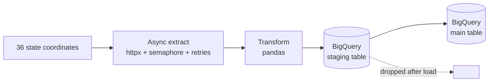

# Air Quality ETL Pipeline

Async Python ETL that pulls hourly air quality data for **36 Indian states and UTs** from the free [Open-Meteo Air Quality API](https://open-meteo.com/en/docs/air-quality-api), transforms it with pandas, and loads it into **Google BigQuery** through a staging table.

## Data source

- Open-Meteo Air Quality API: free, **no account or API key needed**.
- Values are **CAMS (Copernicus) model data** at one representative point per state/UT (usually the capital or a major city). They are **not CPCB station readings** and should not be treated as state-wide averages.
- I originally used the data.gov.in (CPCB) API, but it was returning persistent 503 errors, so I rebuilt the extract step on Open-Meteo.

## Pipeline

1. **Extract:** `asyncio` + `httpx` call the API for all states concurrently (3 at a time). Failed calls retry up to 5 times with exponential backoff.
2. **Transform:** pandas flattens the hourly arrays, drops future forecast hours and empty rows, renames the API fields, and adds two columns: `aqi_category` (US AQI band) and `ingested_at_ist`.
3. **Load:** rows go into a staging table, then only the new `(state, ts)` rows are inserted into the main table. The staging table is then deleted, so re-running never creates duplicates.

## Table schema

| Column | Type | Notes |
|---|---|---|
| state | STRING | State/UT name |
| ts | DATETIME | Hour, IST |
| pm25, pm10, no2, so2, co, o3 | FLOAT | Renamed from API fields |
| us_aqi | FLOAT | US AQI from the API |
| aqi_category | STRING | Derived: Good ... Hazardous |
| ingested_at_ist | DATETIME | Derived: load time |

## Run it (Google Colab)

1. Create a GCP project with BigQuery enabled and set `PROJECT_ID` in the `creds` class.
2. Open the notebook/script in Colab and run it. Sign in when prompted (`auth.authenticate_user()`).
3. Needs: `httpx pandas pytz google-cloud-bigquery pyarrow db-dtypes` (preinstalled in Colab).

Running locally: remove the `google.colab` lines, run `gcloud auth application-default login`, and use `asyncio.run(main())` instead of `await main()`.

By default it loads **yesterday to now**. To backfill, change the start date `d0` in `extract()`, for example to `"2026-01-01"`.

## Limitations

- One point per state, so values are indicative, not official.
- Model data, not ground-station measurements.
- Not scheduled yet: run it manually or add Cloud Scheduler / Cloud Run Jobs.

## Tech stack

Python, asyncio, httpx, pandas, Google BigQuery, GCP
